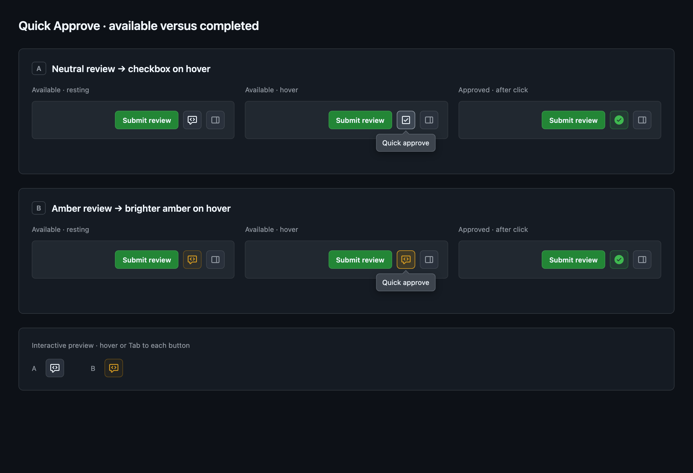

# GitHub Quick Approve

Status: approved design, implemented locally. Created: 11/10/26.

## Objective

Add one compact approval button to every GitHub PR page. Clicking it submits an approval immediately using GitHub's REST API and a personal access token. The button stays in the PR header and communicates whether approval is available without requiring a hover.

The user approved the visual mockups and token setup/recovery flow, selected the token-backed API approach, and limited support to GitHub's new PR interface. Other implementation defaults below are proposed builder decisions unless explicitly identified as approved.

## Scope & constraints

Support github.com in Chrome (Manifest V3), **only in the new PR interface described below**, across Overview, Commits, Checks, Files changed, and commit detail pages within that interface. Legacy PR views are out of scope; do not add selectors or compatibility code for them. Direct loads, browser back/forward, and navigation without a full page reload must produce exactly one button for the current PR. Non-PR pages have no button.

Approval requires one click, with no confirmation and no review message. The extension does not merge, request changes, dismiss reviews, or edit GitHub's existing review controls. V1 ships as an unpacked extension with installation instructions; Web Store publishing, GitHub Enterprise hosts, OAuth, and multiple saved tokens are out of scope.

## Approaches

**Selected: REST API with a user-provided token.** This follows Refined GitHub's quick-approve mechanism and gives every PR tab the same submission path. The API contract is documented; installation requires token setup. The user selected this after reviewing the alternative.

Alternative: submit GitHub's existing review form using the browser session. This avoids token setup, but couples submission to GitHub's markup and review dialog lifecycle, particularly on pages without a review form. We retain DOM integration for placement only.

## User experience

**The approved visual is a 32 px square button placed immediately after Submit review**, with an 8 px gap. On tabs without that control, place it in the corresponding PR header action group. Keep it visible with the header while scrolling where GitHub provides a sticky header. Match GitHub's typography, borders, radii, and light/dark theme variables. Do not introduce a floating widget or move existing actions.

### Approved PNG mockups

The user's current new PR interface is the implementation target. Its top PR action bar contains Merge status and Submit review, above the Overview/Commits/Checks/Files changed tabs. Insert the button immediately after Submit review and before the separator and existing icon actions.

Use generic toolbar mockups in this design and future documentation. Do not include the user's repository name, PR title, source code, or other identifying repository content in screenshots.

The user selected **option B (amber review)** in the designer's revised board below, then requested a subtler hover matching adjacent GitHub buttons. The stronger amber hover in this prototype is superseded by that refinement. The available action keeps Primer's code-review icon at rest and on hover; hover uses GitHub’s default button background token (with a small neutral fallback overlay), preserving the resting border and icon color. Keyboard focus uses the normal focus ring. Only successful approval displays the filled green check-circle. Option A is shown for comparison and is not selected.

Surrounding native actions are illustrative; render only actions GitHub itself provides for that PR. The tooltip uses a top-layer popover to remain visible outside clipped headers and is available on hover and keyboard focus.

### Button states

Approved resting states:

- Available: amber Primer code-review icon with a subtle amber background and border; hover subtly changes the background without brightening the border or changing the icon; tooltip "Quick approve".
- Already approved: filled green check-circle on a subtle green background; tooltip "You approved this PR"; disabled.
- Merged: purple merge icon; tooltip "This PR is merged"; disabled.
- Own PR: muted gray lock; tooltip "You can't approve your own PR"; disabled.
- Closed without merging: muted red closed-PR icon; tooltip "This PR is closed"; disabled.

Additional builder defaults: loading and submission use a spinner and disable the button. Missing credentials use a neutral key icon; invalid credentials use an amber key icon; clicking either opens extension settings. Other unavailable states use a muted lock with the specific reason. A pending draft review uses the locked state and tooltip "Finish your pending review in GitHub". Errors use a visible error icon plus an accessible short message near the button; the message persists until dismissed or a new attempt starts. Successful approval changes the button immediately without navigating or scrolling.

All states have accessible names and tooltip descriptions available on keyboard focus. Disabled states must remain focusable with aria-disabled so their explanation is discoverable. Icon shape, color, and accessible text distinguish states. Respect reduced motion and narrow viewports.

The approved screenshots establish button appearance and placement. They do not require showing GitHub's Submit review action when GitHub itself omits it (e.g., a merged PR).

### Token setup & recovery

**Missing token:** show a neutral key icon in the same button position, with tooltip and accessible label "Set up Quick Approve". It remains clickable. Clicking opens the extension's options page in a new tab, keeping the PR open. Do not automatically open settings on install or on every PR navigation.

The options page explains that the token is used to approve as the user and is saved only in this Chrome profile. The GitHub token creation link prefills the name GitHub Quick Approve, description, 180-day expiration, and Pull requests read/write permission. Per the user's preference, setup instructs the user to select the resource owner and All repositories. GitHub's documented URL parameters do not include repository selection; that choice remains manual and covers the selected owner. Use a masked token field and a "Save token" button.

Saving validates the candidate token against GitHub's authenticated-user endpoint before persisting it. While checking, disable Save and show "Checking token…". On success, clear the field and show "Connected as <username>" and "Return to your PR". Keep the setup tab open so the result is visible. Open PR tabs refresh through an extension notification; when the user returns, the button reflects the current PR state. **Saving or replacing a token never submits an approval**; the user clicks the amber review button after returning.

If validation fails, keep the candidate masked and editable, explain the error inline, and leave Save available for a corrected attempt. Do not overwrite a working saved token with an invalid candidate. A network failure says "Couldn't reach GitHub. Try again" rather than claiming the token is invalid. Displaying a connected account verifies identity, not write permission for every repository.

**Invalid saved token:** if GitHub rejects its authentication, invalidate cached eligibility and show an amber key icon with tooltip "GitHub token expired or invalid. Update token". Clicking opens options with the same message and a replacement field. Stop retrying the rejected token during navigation/focus until the user supplies a replacement. Keep Remove available. A token invalidated during a click never causes automatic resubmission after recovery.

**Valid token, unavailable repository or permission:** preserve the token and show the muted lock with an actionable message. Offer settings and Retry in the error message. Insufficient access, SSO/organization restrictions, rate limits, and temporary failures must not all be labeled invalid token. Use GitHub's error details when available; otherwise say access could not be confirmed. Missing write permission may only become apparent at submission; report it without claiming approval succeeded.

The token remains local rather than using Chrome sync. The default token name is `GitHub Quick Approve`, without a hostname or installation ID.

The user approved this setup and recovery flow. The PNGs cover approval/PR states; the key icons and options page will follow the same native visual styling.

## Components

Use strict TypeScript and CSS, with no runtime framework or runtime dependencies. Per the user's implementation request, building compiles the source to JavaScript in a clean `dist/extension` directory; packaging builds first and creates a ZIP containing only loadable extension assets. The content script compiles as an isolated script without exposing extension resources to the page. The worker and options page use ES modules.

1. A content script recognizes the current PR, reads the signed-in GitHub username, mounts the button, and handles GitHub navigation and DOM replacement. An observer reconciles the control without repeating API requests for unrelated DOM mutations. Stale responses cannot update another PR's button.
2. An extension service worker owns the credential and GitHub API calls. Messages expose fixed operations (load PR state and approve), never arbitrary URLs, methods, or request bodies. Validate the sender is a github.com PR tab, derive or verify its owner/repository/PR number, and call only api.github.com.
3. An extension options page saves, validates, replaces, and removes a token. Include a masked input, Save and Remove controls, validation status, authenticated username, and a link to GitHub token creation instructions. Do not display the saved token again.

Use Chrome extension local storage, restricted to trusted extension contexts. The token persists across browser restarts but is not synchronized or written into the page, messages to content scripts, logs, URLs, screenshots, or repository. Local extension storage is not an encrypted vault; a compromised local profile can expose the token. Only the options page and worker handle it. Request storage permission and host access for github.com content injection and api.github.com requests; no cookie or browsing-history permission.

Use a fine-grained personal access token with Pull requests read/write permission. Default setup guidance selects All repositories for the resource owner, per the user's preference. Accept a compatible classic token for users who need it; document private-repository scope and organization/SSO restrictions. The token's authenticated user must match the signed-in page user. A mismatch disables approval and explains which account needs changing; never approve silently as another account.

## State & submission

Read the authenticated API user, PR metadata, and all pages of PR reviews. Compare numeric user IDs for author and reviewer identity. State precedence is merged, closed, account mismatch/setup, own PR, pending review, already approved, available. While loading or unable to determine state, disable approval rather than infer availability.

For already approved, use the user's latest decisive review (APPROVED, CHANGES_REQUESTED, or DISMISSED). Only APPROVED disables the button. COMMENTED reviews do not erase a decisive review; DISMISSED clears an older approval rather than resurrecting it. This state means the user's approval exists; it does not claim all branch protection or merge requirements are satisfied. On new commits, requery GitHub; do not infer dismissal solely from a changed head SHA.

Refresh on initial mount, PR navigation, a semantic change to GitHub’s PR status badge, return to a visible/focused tab, credential change, and immediately before submission. Badge markup is only an invalidation signal; the API remains authoritative. If the badge changes during approval submission, refresh after the submission completes so a late approval result cannot overwrite a merged state. Unrelated DOM updates reuse an in-flight state read rather than superseding it. Avoid background polling. Bound simultaneous duplicate requests within the worker and disable the UI while a submission is in flight. Clear cached state when credentials change. Per-account/PR locks cover overlapping tabs within the running worker; durable attempt records preserve uncertain outcomes after worker or browser restart, as specified in Security.

**A click creates a new approval only after the latest state is confirmed eligible.** Pin it to the PR head SHA shown in the loaded state. If preflight finds a different head SHA, update the state and ask for a fresh click with "New commits arrived. Review the changes before approving." If navigation changes the PR while preflight runs, cancel the action. This does not add a confirmation dialog to the normal path.

Send a create-review request with event APPROVE, the checked commit ID, and no body/comments. Never submit or modify a pending draft review. If one exists, direct the user to GitHub's review UI. On confirmed API success, render Approved and refresh authoritative state. If a response is lost or times out, enter an uncertain state and requery reviews; an absent review does not prove the write failed. Keep submission blocked until authoritative reconciliation or explicit recovery, and never automatically retry a write. A commit arriving after preflight can still leave approval attached to the checked SHA; GitHub's review policies remain authoritative.

Handle expired tokens, inaccessible repositories, insufficient permission, organization restrictions, rate limits, and validation failures with short actionable messages. Do not claim permission is known before GitHub establishes it. An API denial leaves approval unavailable for that attempt and offers Retry after the underlying issue is fixed. Never translate an ambiguous response into success.

## Security

**The extension holds a credential capable of acting as the user; the worker must expose only the PR operations this feature needs.** The protected assets are the token, the user's review identity, private PR metadata, and the integrity of the repository/PR/commit being approved. One-click approval deliberately omits a confirmation dialog; a genuine activation of the visible button is the normal authorization event.

### Trust boundaries & threat model

The options page and service worker run in the extension origin and are trusted with the token. The content script runs in Chrome's isolated world but reads an untrusted page DOM. GitHub's API is authoritative for authenticated identity, PR metadata, reviews, and write results. Page titles, links, messages, icons, and DOM attributes are not authority to choose an API destination or change the token.

Consider accidental double clicks and stale tabs; malicious repository content; a web page attempting to invoke extension privileges; manipulated DOM or error responses; and a stolen local Chrome profile. A compromised browser, extension package, or github.com script execution can subvert the workflow. The controls below limit ordinary web content and implementation mistakes; they do not make an inline button a trusted display in a hostile page.

### Credential lifecycle

**Only the extension options page can add, replace, or remove a token.** The worker accepts credential-management messages only from its exact packaged options URL and own extension ID, not a github.com content script or an arbitrary extension-origin page. The input is masked and never populated with the saved value. Candidate tokens stay in the options page and worker until validation; clear the input after success and on page close. JavaScript strings do not provide reliable memory zeroization.

Restrict local storage to TRUSTED_CONTEXTS before persisting a token and before processing worker messages on startup. Feature-detect storage.local.setAccessLevel and fail closed if it is unavailable or the restriction cannot be established; do not save or use credentials. Content scripts receive only normalized state, account display information, and safe errors. Never expose storage snapshots or token values. Notifications about credential changes carry no secret.

Save only the active token and required account/status metadata. Replacing or removing it clears prior credential references and eligibility caches, cancels pending validation/reads, and prevents queued approvals from using the old credential. An already dispatched write cannot be recalled. Each operation captures a credential generation and checks it again before dispatch; a late validation response cannot restore a removed token. Remove deletes the local credential; explain that revoking the token at GitHub is a separate action. Do not promise removal erases filesystem backups or copies previously taken from the profile.

Use an expiring fine-grained token restricted to the selected resource owner and Pull requests read/write. The user selected All repositories as the setup default, so the grant includes that owner's current and future repositories rather than a repository allowlist. A classic token can grant substantially broader permissions; document that tradeoff adjacent to setup instructions. Token permissions bound damage if the extension or profile is compromised. No telemetry, analytics, remote error collection, or external backend receives credentials or PR data.

### Messages, permissions & network requests

Use an isolated-world, top-frame content script. Do not provide externally_connectable access, page-script injection, a window.postMessage/custom-event bridge, or web-accessible extension pages. Approval starts only from a trusted native click/keyboard activation handled by the content script; synthetic .click() and dispatched events must not submit. This is a local event check, not a worker-verifiable proof of human intent.

The worker validates the extension ID, sender tab, top-level frame, document identity, exact HTTPS github.com origin, and PR route on every PR operation. Derive the target from the browser-supplied sender URL; confirm the tab's current URL before a write. Reject mismatched message targets, unsupported operations, malformed owner/repository names, nonpositive or unsafe PR numbers, and unexpected credential fields. Credential commands have a separate options-only path. Never accept a caller-supplied HTTP URL, authorization header, method, review event, body, or review ID for mutation.

The worker constructs API routes under the fixed HTTPS api.github.com origin. Encode each validated path segment. Reject redirects for authenticated requests. For paginated reads, construct the next page from the validated endpoint and numeric page index; do not fetch arbitrary Link-header URLs with the token. Omit ambient cookies. Set timeouts and return sanitized, bounded error messages; do not echo request headers, raw response bodies, or token input. Render external strings using textContent, and use fixed GitHub URLs for setup links.

Request only storage, github.com content access, and api.github.com host access. Package all JavaScript, styles, and icons; no remote scripts, eval, inline handlers, or runtime dependency loading. Use a restrictive extension-page CSP with scripts limited to packaged code and network access limited to the GitHub API. Do not request cookies, history, debugger, native messaging, broad host access, or externally exposed messaging.

### Approval integrity & residual risk

**The worker rechecks identity, eligibility, target, and commit before every write.** Compare the API identity with the signed-in GitHub account, fail closed when page identity is absent or ambiguous, and fetch PR author/head/state from the API rather than trusting DOM data. Bind each attempt to its initiating tab/document, route generation, PR, credential generation, and displayed head SHA. The content script increments its route generation on every detected PR route transition (including A to B to A); document identity alone is insufficient because in-page navigation can retain the document. Before dispatch, obtain a fresh acknowledgment from that content script confirming the captured generation, PR, account, and SHA still match, and recheck the browser's current tab URL. Cancel on mismatch, missing acknowledgment, or a disconnected document. An old long-lived messaging port is not proof of the current route. Repository transfer/rename redirects stop the attempt and require loading the canonical PR URL.

Keep per-account/PR writes serialized across tabs. Before dispatching POST, persist a small attempt record containing a generated attempt ID, numeric account ID, repository/PR identity, checked SHA, and the review IDs known before dispatch. If persistence fails, do not send the write. The record contains no token or review body and survives worker/browser restarts. A record written just before a crash may describe an unsent request; handle it as uncertain rather than assume it is safe to retry.

Resolve the record on a definitive successful API response (including the new review ID), a definitive rejection without mutation, or an authoritative read showing a new matching APPROVED review for that account, PR, and SHA. Do not treat time elapsed, an empty review result, a timeout, a generic server error, or credential replacement as proof of failure. While unresolved, block further approvals for that account/PR across tabs and restarts. Preserve the record across Remove/replacement so re-adding the same account cannot bypass it; once resolved, delete the record. Only retain metadata needed for unresolved attempts, and do not export it.

Recovery shows "Approval result unknown. Check the PR's review history before retrying" with a GitHub review-history link and Recheck. If reads cannot resolve it, offer an explicit "Allow another attempt" recovery action with a warning that another approval may be created. This acknowledges the uncertainty and clears the block; it does not submit. A fresh click on Quick approve is still required. This exceptional recovery is separate from the normal one-click path.

Never auto-submit after setup, token replacement, retry recovery, or navigation. A pending review remains untouched. Preserve GitHub's authorization and branch-protection decisions; the extension cannot promise merge eligibility.

There is no atomic transaction between the browser URL check, GitHub's head check, and the approval request. Navigation or a push can race the final dispatch. The target and commit captured by the attempt remain fixed; do not redirect the approval to a newly displayed PR or silently approve a newer commit. GitHub may record approval against the checked older commit, subject to its policies.

**A compromised GitHub page can disguise or move the injected button and mislead the user into a real click.** Trusted-event checks prevent simple scripted clicks, but do not prevent clickjacking or DOM deception. Account matching also depends on page-provided identity and is not cryptographic proof of the browser session's account. Mitigating those threats fully would require a trusted extension UI/confirmation instead of the approved inline one-click flow. Local malware or a compromised extension can obtain the saved token and use its granted permissions directly. These are explicit residual risks, not guarantees provided by isolated worlds or local storage.

### Security acceptance checks

Before implementation is considered ready, verify credential storage is inaccessible to content scripts; content scripts cannot invoke credential management; foreign origins, child frames, arbitrary destinations, redirects, malformed messages, and synthetic activations cannot produce writes. Verify token replacement/removal during validation/preflight cannot revive credentials or dispatch queued writes with the old token. Check pagination, rendered errors, and logs for credential or private-data leakage. Exercise navigation (including A to B to A), head changes, mismatched identities, duplicate tabs, pending reviews, and uncertain writes with assertions about actual API calls, not only button appearance. Terminate/restart the worker and browser after attempt persistence, during POST, and after a server-side success with a lost response; assert that absent reconciliation never silently unlocks another write.

The [independent security review](2026-11-10-quick-approve-security-review.md) records the design findings and subsequent source review. Implementation verification includes the loaded extension in Chromium, content-script credential isolation, and uncertain-write recovery across a browser restart. Live authenticated GitHub behavior still requires validation against the user's rollout; fixture-based browser tests do not establish that compatibility.

## Verification & delivery

Exercise the loaded extension end to end in a Chromium browser using deterministic GitHub page fixtures and intercepted API responses. Cover all approved states, setup and account mismatch, pending reviews, pagination, dismissed reviews, repeat clicks, changed commits, navigation during requests, multiple tabs, errors, and uncertain submission outcomes. Verify direct loads and in-page navigation across PR tabs, light/dark themes, keyboard focus, narrow layouts, and replacement of GitHub's header. Inspect screenshots against the approved mocks.

Use focused unit tests for review-state reduction, route parsing, and worker request validation where browser tests do not isolate those boundaries well. Run lint, tests, and extension validation before delivery. Include a manual installation and token setup walkthrough. A live test on the user's real GitHub account requires a designated test PR; do not approve an arbitrary real PR as a test. Clearly distinguish fixture verification from live GitHub verification.

## References

- [GitHub review API](https://docs.github.com/en/rest/pulls/reviews): review creation, review listing, and token permissions.
- [Chrome extension storage](https://developer.chrome.com/docs/extensions/reference/api/storage): local storage and trusted-context access controls.
- [Refined GitHub quick-review](https://github.com/refined-github/refined-github/blob/main/source/features/quick-review.tsx): token-backed approval precedent.
- [GitHub REST authentication](https://docs.github.com/en/rest/authentication/authenticating-to-the-rest-api): invalid credentials, permission failures, and organization authentication restrictions.
- [Chrome extension security guidance](https://developer.chrome.com/docs/extensions/develop/security-privacy/stay-secure): least privilege, isolated execution, and safe message handling.
- [Chrome cross-origin request guidance](https://developer.chrome.com/docs/extensions/develop/concepts/network-requests): fixed request destinations and safe rendering of remote data.
- [Chrome extension service worker lifecycle](https://developer.chrome.com/docs/extensions/develop/concepts/service-workers/lifecycle): worker termination and loss of in-memory state.

## Left to the builder

Choose file boundaries, exact GitHub selectors and fallback anchors, test tooling, API caching details, and icon SVG paths. Preserve the behavior and credential boundary above. If GitHub's actual markup prevents the approved header placement on a supported tab, bring back a screenshot and a concrete alternative before changing the placement.
